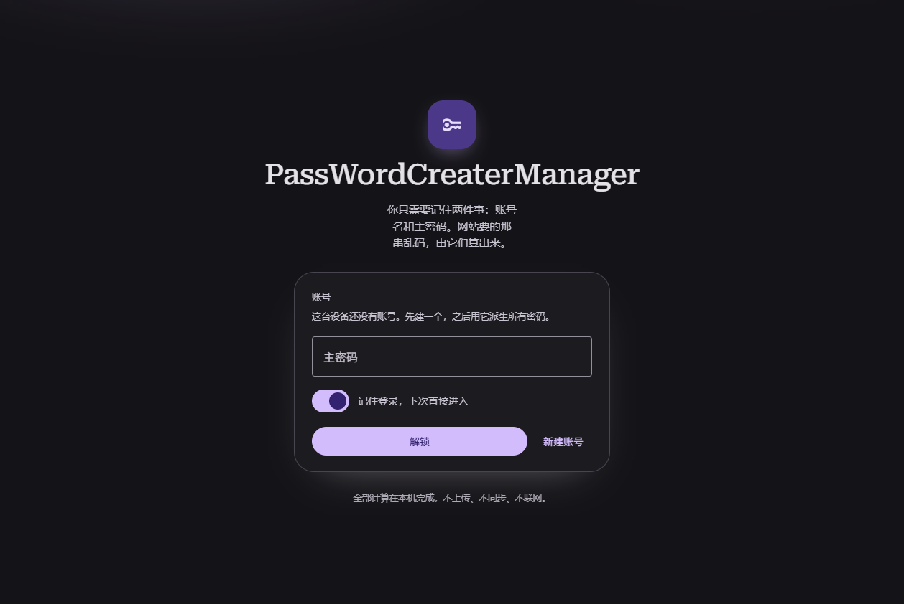
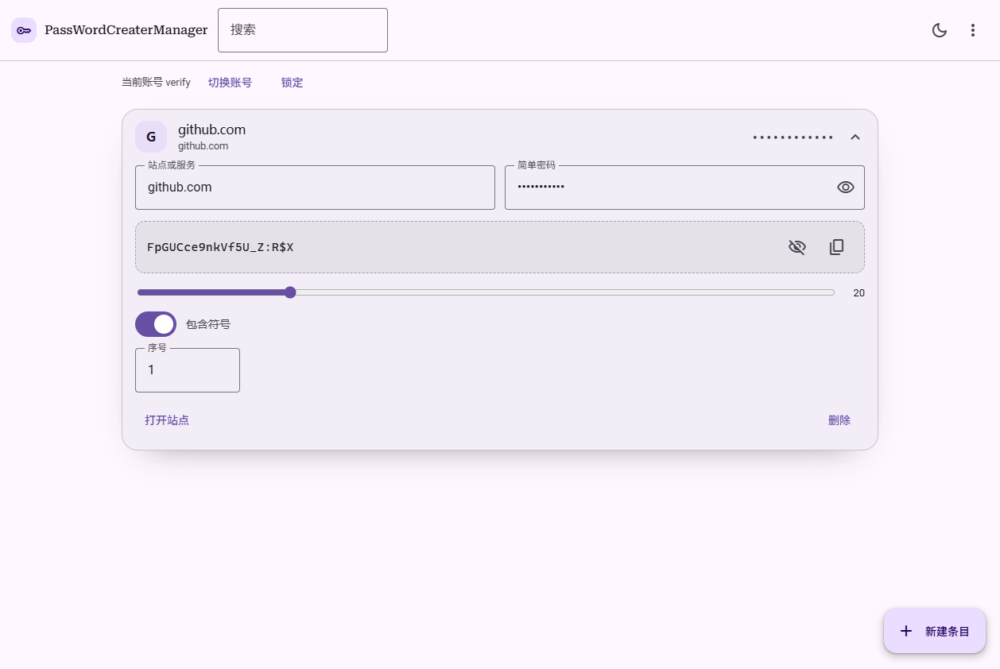
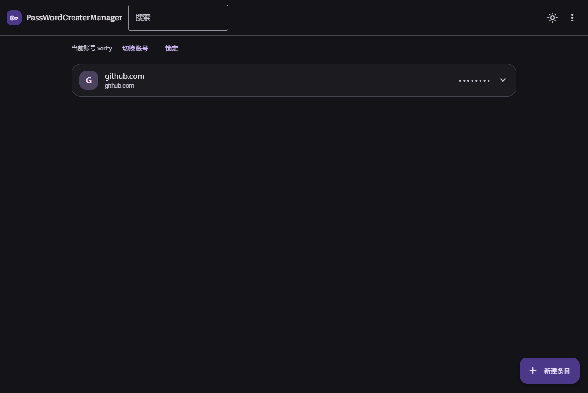

**Languages**: [简体中文](README.md) | English

# PassWordCreaterManager

Deterministic derivation of site passwords from two locally retained secrets, offline, for Windows and Android.

## Motivation

The project started from a mundane irritation: passwords got forgotten, and every change of device or account turned into another reset. A written list invites reuse and copy-paste; remembering a handful of strong passwords proved unreliable in practice.

Deterministic derivation solved both problems with one mechanism, so the tool was written for private use: open it when a password is needed, read the derived string, close it.

Convenience set the priorities. Hardening received no attention during development, which means no secure-enclave integration, no memory-zeroing discipline, no protection against a compromised host, and no audit. A threat model that includes a hostile local environment calls for a different tool.

## Status

A personal project, built for learning and for the publisher's own daily use. It runs as a demonstration of deterministic offline derivation, and carries the constraints that follow: a single maintainer, no support channel, no external audit.

Computation happens entirely on the device. Telemetry, analytics, remote logging, sync, and any server component are absent by construction.

The derivation parameters are frozen at version 2. Any change to them changes every password the application has produced, so they hold as constants.

## Overview

Two layers of secret feed a key derivation function. Nothing that can reconstruct a derived password is stored; each password is recomputed on demand.

Layer 1 belongs to the application: an account name and a master password, held on the device only.

Layer 2 belongs to a single entry: the account name used on a site and a simple password of the kind a person would reuse anyway, for example `github-2019`.

Both layers are folded into a salt, stretched with PBKDF2, and expanded into a byte stream that selects characters from a fixed charset.

### Derivation pipeline

Inputs: `appName`, `appPassword`, `site`, `simple`, `length`, `counter`, `symbols`.

1. Normalization: `norm(x) = trim(x).toLowerCase()`.
2. Salt: `"pwvault:v2" + "|" + norm(appName) + "|" + norm(site) + "|" + simple`.
3. Key: `PBKDF2-HMAC-SHA256(appPassword, salt, 100000 iterations, 32 bytes)`.
4. Stream: `HMAC-SHA256(key, norm(site) + ":" + counter + ":" + block)` for `block = 0, 1, 2, ...`, concatenated until sufficient bytes exist. This stream is the only source of randomness.
5. Selection: stream bytes are mapped onto `lower + upper + digits + symbols` by rejection sampling, skipping any byte `>= 256 - (256 % pool.length)`. The symbol set is `!@#$%^&*()-_=+[]{}:,.<>?/`.
6. Class guarantee: at least one character of each enabled class is present in the result.
7. Ordering: Fisher-Yates, driven by the same stream.
8. Length: clamped to `8..64`. The counter is a per-entry integer; incrementing it yields an unrelated password for the same site.

The output is the string registered on the target site.

### Test vectors

Shared inputs: application account `allpay`, application password `123456`, site account `ABC`, simple password `github-abc`.

| length | counter | symbols | expected output |
| --- | --- | --- | --- |
| 16 | 1 | yes | `?XtHrM3>1As%iPT*` |
| 24 | 1 | no | `TGstXqMWTIxAPH8TQiZwHTes` |
| 20 | 2 | yes | `>%}3/:>.&U>vO#}/K^{h` |

Because inputs are normalized, `ALLPAY` and ` allpay ` derive the same passwords as `allpay`. A build whose output differs from this table is defective.

## Threat model and limitations

The design addresses password reuse: a password disclosed by one site reveals nothing about other sites and nothing about either layer.

It does not address the following.

- A compromised device. Code executing in the application context can read the master password during entry and read derived passwords as they are produced.
- A keylogger, in software or hardware.
- Loss of the master password. No reset, recovery code, or vendor escrow exists; without layer 1 every derived password becomes unrecoverable.
- A modified build. The offline property holds for this source and the binary compiled from it; a substituted WebView2 assembly or a repackaged APK can behave arbitrarily.
- A low-entropy simple password. Layer 2 carries little entropy by construction; the KDF raises the cost of guessing without turning `1234` into a strong secret.
- Access to an unlocked session.

Only inputs are stored. A leaked application database exposes layer 1 and every simple password, which is equivalent to a leaked password-manager vault.

## Build

Requirements: Node.js 20 or later for the web assets; .NET Framework 4.8 with `csc.exe`, included in Windows, for the desktop host; JDK 17 and the Android SDK for the Android shell.

### Web

```bash
npm ci
npm run build        # emits dist/
```

Both native shells embed the contents of `dist/`.

### Desktop

```powershell
.\desktop\build.ps1
```

The script packs `dist/` into an embedded resource, compiles `desktop/src/Launcher.cs` into `PassWordCreaterManager.exe`, and copies the WebView2 assemblies alongside it. The Microsoft.Web.WebView2 package is located under `%USERPROFILE%\.nuget\packages`; `-WebView2Dir <path to lib\net462>` overrides that lookup.

The output directory requires `PassWordCreaterManager.exe`, `Microsoft.Web.WebView2.Core.dll`, `Microsoft.Web.WebView2.WinForms.dll`, and `WebView2Loader.dll`. The executable does not start without them, and the machine requires the WebView2 runtime, which ships with Windows 11 and current Windows 10.

### Android

```bash
cd android
gradlew assembleRelease        # ANDROID_HOME and JAVA_HOME must be set
```

The APK is written to `android/app/build/outputs/apk/release/`. The committed `app/debug.keystore` is a throwaway debug key present so the release build runs without local setup; it carries no distribution or security value.

## Architecture

Web interface: TypeScript, Vite, Material Web components (`@material/web`), Material 3 Expressive styling, light, dark and system themes, five accent seeds, IndexedDB for storage. Derivation executes in the page through WebCrypto; no part of it is native.

Desktop host: a .NET Framework 4.8 WinForms window embedding WebView2. The page is served from an embedded zip through a virtual host mapped to `https://app.local`. The origin is fixed deliberately: IndexedDB is scoped per origin, so a stable origin keeps the local database intact across restarts and upgrades. Backups are written through the host bridge into the Downloads folder.

Android host: a minimal `WebView` shell built with AGP 8.13 (`compileSdk 36`, `minSdk 24`). Assets are served by `WebViewAssetLoader` at `https://appassets.androidplatform.net`, and a JavaScript bridge named `pvb` writes backups into the public Downloads collection.

## Usage

First launch: creation of an application account, consisting of a name and a master password of at least eight characters. The lock screen lists existing accounts as chips and requires the matching master password. The remember option stores that choice and reopens the vault directly on subsequent launches; locking returns to the lock screen.

Adding an entry: a note, the site or service, an optional URL, and the simple password. The derived password appears immediately, masked. A reveal control unmasks it, and the copy control works whether or not the value is revealed. A slider sets the length, a switch controls the symbol class, and the counter field produces independent passwords for the same site, which is the rotation mechanism.

Locating an entry: the search field filters by note, site, account, or URL. `Ctrl+K` focuses it and `Ctrl+N` creates an entry.

Backups: the menu exports a JSON file, imports a file, or imports pasted JSON. Import merges accounts by name and discards duplicate entries. An export is a credential and should be stored accordingly.

Wiping: the menu clears the IndexedDB database and reloads into the first-launch state.

## Repository layout

```
PassWordCreaterManager/
  index.html          entry point for the Vite build
  src/                TypeScript sources: main.ts, db.ts, derive.ts, theme.ts, styles.css
  brand/              icon source (SVG), rasterized PNG, generated ICO
  desktop/            .NET Framework WinForms host and build.ps1
  android/            Gradle project, WebView shell
  docs/screenshots/   screenshots used below
  dist/               build output, not tracked
```

## Screenshots

| Lock screen | Entry | Dark theme |
| --- | --- | --- |
|  |  |  |

## Backup file format

UTF-8 JSON with two-space indentation. The `accounts` array carries layer 1 and the `entries` array carries layer 2. Derived passwords stay out of the file entirely; they are recomputed from the stored inputs.

```json
{
  "format": "password-creater-manager-backup",
  "version": 1,
  "exportedAt": "2026-01-01T00:00:00.000Z",
  "accounts": [
    {
      "name": "allpay",
      "password": "master password, in clear",
      "createdAt": "2026-01-01T00:00:00.000Z"
    }
  ],
  "entries": [
    {
      "accountName": "allpay",
      "note": "GitHub",
      "site": "github.com",
      "url": "https://github.com",
      "password": "layer-2 simple password, in clear",
      "length": 20,
      "counter": 1,
      "symbols": true
    }
  ]
}
```

`format` is validated on import. Files produced by the earlier PwVault build (`"format": "pwvault-backup"`) remain accepted.

## Data locations

- Web preview: IndexedDB database `PassWordCreaterManager` inside the browser profile.
- Desktop: `webview2data/` beside the executable, origin `https://app.local`.
- Android: WebView storage for `https://appassets.androidplatform.net`.

## Compatibility

Frozen: the salt prefix `pwvault:v2`, PBKDF2-HMAC-SHA256 at 100000 iterations with a 32-byte output, the HMAC-SHA256 stream construction, the charset and its ordering, rejection sampling, the one-character-per-class rule, Fisher-Yates over the same stream, and the `8..64` clamp. The salt prefix retains its original spelling so passwords derived by earlier builds remain valid; as an input string it happens to predate the current name.

Windows and Android share one implementation and must remain byte-identical. The vectors above are the check.

## License

MIT, see [LICENSE](LICENSE).

## AI disclosure

This project was generated by an AI coding agent (DeepSeek-based) from a specification written by the publisher, then reviewed, built, and tested by hand. The derivation algorithm, the web interface, the desktop host, and the Android shell were all produced this way, and the vectors above were recomputed from an independent implementation and cross-checked against both shipped builds. The source is short enough to audit end to end, in particular `src/derive.ts`.